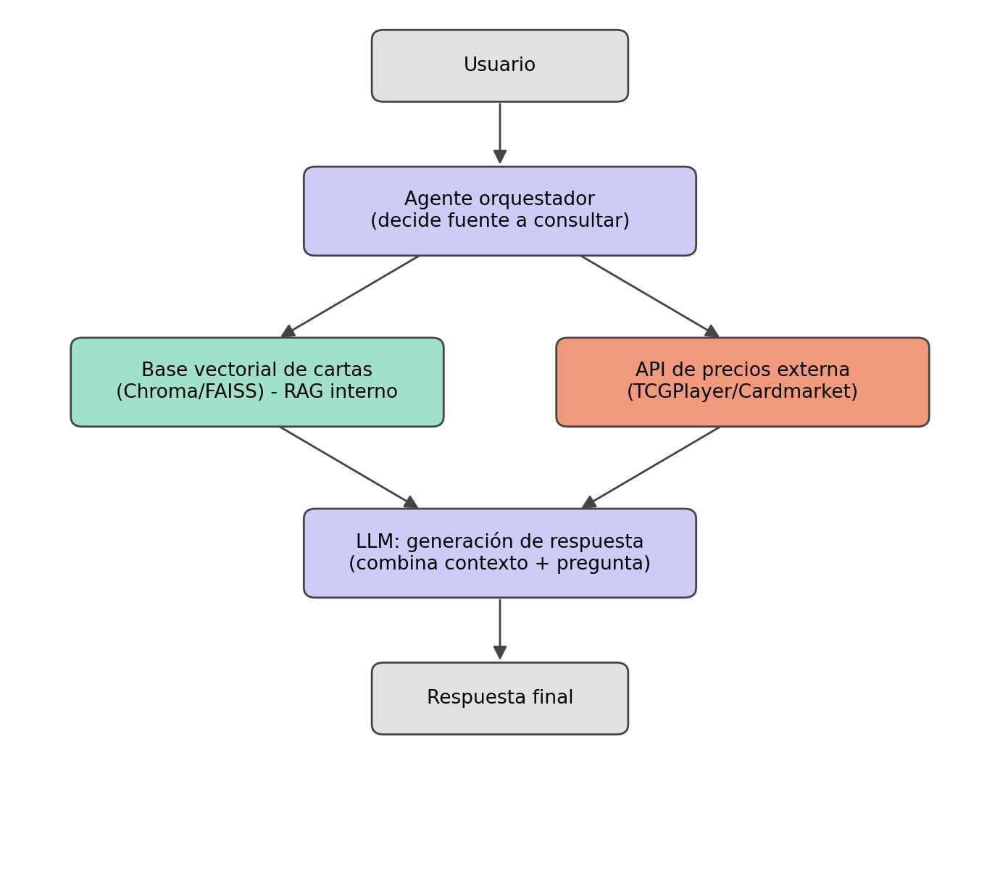

# Pokémon TCG RAG — catálogo completo + asistente con IA

Sitio web y agente con recuperación aumentada (RAG) sobre **todas las cartas de
Pokémon TCG**: 176 sets y más de 20.600 cartas, desde Base Set (1999) hasta la
serie Mega Evolution (2026), con imágenes, ataques, habilidades, legalidad y
precios de mercado en vivo.

Proyecto desarrollado inicialmente para la Evaluación Parcial N°1 — ISY0101
Ingeniería de Soluciones con IA (Duoc UC), y extendido para desplegarse en un
dominio propio.

## Qué incluye

- **Explorador de cartas**: búsqueda por nombre, ataque, habilidad o artista;
  filtros por set, tipo, categoría, rareza y formato estándar; ficha de cada carta
  con imagen en alta resolución, otras impresiones y precios (TCGPlayer / Cardmarket).
- **Navegación por sets**, agrupados por serie.
- **Asistente** en español: entiende consultas como *"carta de tipo Dragón con
  más de 200 HP y habilidad de curación"* o *"¿cuánto vale Umbreon VMAX?"*, y
  responde citando cartas reales (con sus imágenes).
- **API REST** documentada en `/api/docs`.
- Listo para producción: Docker, HTTPS automático con Caddy, límite de consultas
  por IP, pruebas automatizadas y CI.

## Arquitectura



1. El usuario consulta desde la web (`web/`) o la consola (`src/main.py`).
2. `src/query_parser.py` detecta nombres de cartas y filtros (tipo, HP, set,
   categoría, estándar) en español o inglés, y si se pide un precio.
3. El **agente** (`src/agent.py`) elige la ruta:
   - **Precio** → `src/tools/price_api.py` consulta la API de pokemontcg.io en vivo
     (con caché) para cada impresión de la carta.
   - **RAG** → `src/rag_pipeline.py` hace una recuperación **híbrida**:
     cartas nombradas (SQLite), búsqueda semántica con filtros (Chroma) y
     respaldo de texto completo (FTS5).
4. El **LLM** (`src/llm_client.py`: Groq, Claude u OpenAI-compatible) redacta la
   respuesta usando solo las cartas recuperadas. Sin API key, el sistema sigue
   funcionando y muestra las cartas encontradas.

| Componente | Archivo | Tecnología |
|---|---|---|
| Fuente de datos | `src/data_sources.py` | [PokemonTCG/pokemon-tcg-data](https://github.com/PokemonTCG/pokemon-tcg-data) |
| Catálogo y filtros | `src/catalog.py` | SQLite + FTS5 |
| Embeddings | `src/embeddings.py` | fastembed (ONNX, CPU) — modelo multilingüe |
| Base vectorial | `src/vector_store.py` | Chroma |
| API + web | `src/api.py`, `web/` | FastAPI, HTML/CSS/JS sin dependencias |

## Desplegar en tu dominio (VPS + Docker)

Requisitos: un servidor Linux con Docker (2 GB de RAM recomendados, ~3 GB de disco)
y un dominio.

1. En tu proveedor de DNS crea un registro **A** de tu dominio (por ejemplo
   `tcg.midominio.cl`) apuntando a la IP del servidor. Abre los puertos 80 y 443.
2. En el servidor:

   ```bash
   git clone https://github.com/Daartw/TCG-rag.git
   cd TCG-rag
   cp .env.example .env
   nano .env        # DOMAIN, ACME_EMAIL y GROQ_API_KEY
   docker compose up -d --build
   ```

   La primera construcción descarga el catálogo y genera los embeddings de las
   ~20.600 cartas (10–20 min según el servidor). Después la imagen arranca en
   segundos. Caddy obtiene el certificado HTTPS automáticamente.
3. Abre `https://tu-dominio`. Estado del servicio: `https://tu-dominio/api/health`.

**Actualizar el catálogo** cuando salga un set nuevo:

```bash
git pull
docker compose build --build-arg CACHE_BUST=$(date +%F) app && docker compose up -d
```

### Otras plataformas

- **Render**: `New > Blueprint` con este repo (usa `render.yaml`), agrega
  `GROQ_API_KEY` y luego tu dominio en *Custom Domains*.
- **Railway / Fly.io / Coolify / Dokploy**: despliega el `Dockerfile`; la app
  escucha en `$PORT`. Configura el dominio en el panel de la plataforma (no hace
  falta Caddy).
- Para una imagen más liviana que indexe al primer arranque:
  `--build-arg BUILD_INDEX=false` (en ese caso monta un volumen en `/app/data`).

### Imágenes en tu propio servidor (opcional)

Por defecto las imágenes se cargan desde el CDN de `images.pokemontcg.io`. Para
servirlas tú mismo:

```bash
docker compose exec app python scripts/mirror_images.py           # miniaturas (~1 GB)
docker compose exec app python scripts/mirror_images.py --large   # + alta resolución (~12-15 GB)
# luego en .env: IMAGE_BASE_URL=/images  y  docker compose up -d
```

## Desarrollo local

```bash
python -m venv .venv
source .venv/bin/activate          # Windows: .venv\Scripts\activate
pip install -r requirements-dev.txt
cp .env.example .env               # completa GROQ_API_KEY (opcional)

python -m src.ingest               # todo el catálogo (o --sets swsh7,sv1 para probar rápido)
uvicorn src.api:app --reload       # http://localhost:8000
python -m src.main                 # asistente por consola
pytest                             # pruebas (sin internet ni API keys)
```

Opciones de `src.ingest`: `--sets`, `--refresh` (vuelve a descargar los datos),
`--skip-vectors` (solo SQLite) y `--force-vectors`.

## Variables de entorno principales

| Variable | Descripción |
|---|---|
| `DOMAIN`, `ACME_EMAIL` | Dominio y correo para el HTTPS (docker-compose) |
| `LLM_PROVIDER` | `auto`, `groq`, `anthropic`, `openai` o `none` |
| `GROQ_API_KEY` / `ANTHROPIC_API_KEY` / `OPENAI_API_KEY` | Clave del proveedor de LLM |
| `CHAT_RATE_LIMIT_PER_MIN` | Mensajes al asistente por IP y minuto |
| `POKEMON_TCG_API_KEY` | Opcional, sube el límite de la API de precios |
| `IMAGE_BASE_URL` | CDN de imágenes o `/images` si las espejas |
| `INGEST_SET_IDS` | Limita la ingesta a ciertos sets |

Ver `.env.example` para la lista completa.

## API

| Método | Ruta | Descripción |
|---|---|---|
| GET | `/api/cards` | Búsqueda paginada (`q`, `set`, `type`, `supertype`, `rarity`, `min_hp`, `max_hp`, `standard`, `sort`, `page`) |
| GET | `/api/cards/{id}` | Ficha completa + otras impresiones |
| GET | `/api/cards/{id}/price` | Precios en vivo (TCGPlayer / Cardmarket) |
| GET | `/api/sets` | Todos los sets |
| GET | `/api/meta` | Totales y opciones de filtros |
| POST | `/api/chat` | `{"message": "...", "history": []}` → respuesta + cartas |
| GET | `/api/health` | Estado del servicio |

## Uso de inteligencia artificial en el desarrollo

En conformidad con la pauta de la evaluación, se declara el uso de herramientas
de IA generativa durante el desarrollo:

| Etapa | Responsable | Uso de IA |
|---|---|---|
| Versión inicial (set Evolving Skies, CLI) | Equipo | Diseño del pipeline RAG, estructura del proyecto, ingesta con reintentos ante errores 5xx e informe técnico, realizados por el equipo. |
| Versión desplegable (catálogo completo y web) | Equipo, con apoyo de Claude (Anthropic) | Se usó Claude como asistente de programación para ampliar la ingesta a todos los sets, implementar la búsqueda híbrida (SQLite + Chroma) y los filtros en español, crear la API web y el frontend, y preparar la configuración de despliegue (Docker, Caddy, Render) y las pruebas automatizadas. |
| Redacción de documentación | Equipo, con apoyo de IA | Apoyo en la redacción de este README. |

**Revisión y validación por parte del equipo:** el código generado con apoyo de
IA fue revisado antes de integrarse al repositorio, y su funcionamiento se
verificó con las pruebas automatizadas (`pytest`) y con consultas reales al
sistema (ver *Evidencia de pruebas*). El equipo es responsable de las decisiones
de diseño y del contenido final entregado.

## Evidencia de pruebas

Agregar aquí (o en `docs/evidencia/`) capturas de consultas reales ejecutadas
contra el sistema, con una nota sobre si la respuesta fue correcta y coherente
con los datos recuperados.

## Créditos y aviso legal

Proyecto no oficial, sin afiliación con Nintendo, Creatures, GAME FREAK ni The
Pokémon Company. Pokémon y los nombres de personajes son marcas de sus
respectivos dueños. Datos e imágenes de cartas: [pokemontcg.io](https://pokemontcg.io).
